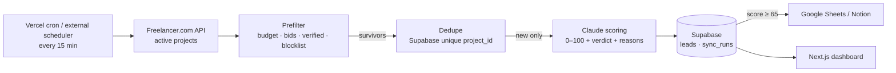

# Lead Radar: LLM-scored lead pipeline for Freelancer.com

Lead Radar polls Freelancer.com for new projects. It filters them with cheap deterministic rules, deduplicates them in Postgres, and asks Claude to score each survivor 0–100 against a written "fit profile". Only strong matches go to Google Sheets or Notion. A dashboard shows everything that was scanned, including what got rejected and why.



## Why this design

- **Rules before the LLM.** Hard filters are free and deterministic, so they run first. A typical run sends about 5–15 projects to the model instead of 100, which keeps cost to cents a day ([ADR-001](docs/decisions.md)).
- **The fit profile is the main control.** Plain-English positives and negatives in `lib/config.ts` drive scoring quality more than keyword tuning does.
- **Graceful failure.** A malformed model response parks the lead at 50 with an `unscored` flag instead of failing the run. Every run is logged to `sync_runs`.
- **Everything is auditable.** Rejected leads are stored too, so the filters can be tuned by looking at what was thrown away.

## Stack

Next.js 15 (App Router) · TypeScript · Supabase (Postgres) · Anthropic SDK · Google Sheets API (service account) · Notion API · Vercel Cron · Tailwind 4

## Project structure

```
app/
  api/cron/poll/route.ts   Cron entry point (Bearer CRON_SECRET)
  api/leads/route.ts       Lead status updates from the dashboard
  components/LeadList.tsx  Score-rail dashboard UI
  page.tsx, layout.tsx
lib/
  config.ts                Search terms, prefilter rules, threshold, fit profile
  freelancer.ts            Freelancer API client + budget normalisation
  score.ts                 Claude scoring with concurrency-limited batching
  pipeline.ts              Orchestrates fetch → filter → dedupe → score → store → push
  supabase.ts
  destinations/sheets.ts   Google Sheets writer
  destinations/notion.ts   Notion writer
scripts/
  list-jobs.ts             Look up Freelancer skill IDs
  scan-once.ts             Run one scan and print a funnel breakdown
supabase/schema.sql        leads + sync_runs tables
```

## Quick start

```bash
npm install
cp .env.example .env      # Freelancer token, Supabase, Anthropic, Sheets or Notion
npm run jobs -- crm       # find skill IDs, paste into lib/config.ts
npm run scan              # one run with stage-by-stage counts
npm run dev               # dashboard at http://localhost:3000
```

Full setup (Supabase schema, Google service account, Vercel cron limits) is in [`docs/setup.md`](docs/setup.md).

## Docs

- [`docs/architecture.md`](docs/architecture.md): pipeline stages, data model, scoring contract
- [`docs/decisions.md`](docs/decisions.md): architecture decision records
- [`docs/status.md`](docs/status.md): what's verified and what's next
- [`docs/setup.md`](docs/setup.md): full setup guide

## My role

I defined the problem, the destinations (Sheets or Notion), the stack (Next.js + Supabase), the choice to use LLM scoring, and the fit profile that encodes my own services. The code was generated with Claude from that specification in August 2026. I've reviewed it and documented the design here.

## Licence

MIT
